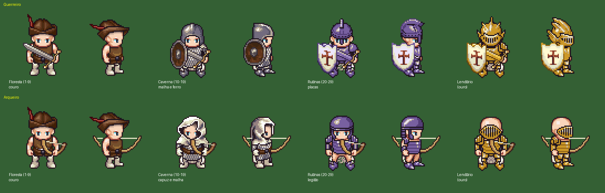

# Etapa 7 – Plano de equipamentos (todas as regiões)

Status: **aprovada por Willian e implementada** (respostas: 1 todos os espaços, 2 aceita o improviso das armas, 3 material por qualidade, 4 conjuntos). Motivo (Willian): a história é curta; o que muda de região para região é cenário e monstro, então **o desenho do equipamento, a percepção de estrutura e os efeitos** carregam boa parte do interesse do jogo.

*Montada com peças reais do gerador LPC (as mesmas que o jogo usaria), de frente e de lado. Ruínas em roxo e Lendário em ouro são recolorações feitas em código.*

## 1. Benchmark (o que os jogos de referência fazem)
| Jogo | Como o equipamento mostra progresso |
|---|---|
| Diablo 2 | Cada item-base existe em 3 níveis (Normal, Excepcional, Elite) com o **mesmo ícone**; o que muda é nome, exigência e números. Qualidade por cor do nome (mágico azul, raro amarelo, de conjunto verde, único dourado). **Conjuntos** dão bônus por quantidade de peças vestidas; itens únicos têm nome próprio. |
| Conquer Online | (fontes fracas; conhecimento de comunidade) Aparência do equipamento muda por faixa de nível e por classe; qualidade Normal → Refinado → Único → Elite → Super; "+1 a +12" e encaixes; equipamento de nível alto e muito melhorado chama atenção pelo brilho. |
| Kritika | Equipamento por grau de masmorra, melhoria até +15 e despertar; visual e brilho crescem com o grau. |

**Padrão comum:** (1) a **silhueta** muda por faixa (região); (2) **cor/material** indica a raridade; (3) **brilho/efeito** indica a melhoria (+N); (4) **conjuntos** dão metas de coleta.

## 2. Restrições (o que corta)
- Só entra peça LPC com todas as animações da classe (Guerreiro: andar, golpear, estocar; Arqueiro: andar, atirar). Catálogo conferido: há bastante armadura (32 capacetes, 13 enfeites, 8 viseiras, 5 ombreiras, 7 braçadeiras/luvas, 12 botas, 3 capas, 7 escudos, 23 cintos, peitorais de couro, malha, legião, placas). **Armas são o gargalo:** só a espada longa e a adaga têm as três animações do Guerreiro; maça, sabre, machado, mangual, florete e espada brilhante não têm estocar. Arcos: simples, recurvo e longo.
- Toda peça entra nos créditos (já automático) e precisa caber no boneco da tela de Personagem (844×390).
- Espaços novos mudam o save: precisa de migração (já é regra do projeto).
- Desempenho: cada espaço é uma camada a mais por quadro; com ~12 camadas o custo segue baixo, mas será medido.

## 3. Adaptação proposta
### 3.1 Silhueta por região (o "nível" do equipamento)
| Região | Guerreiro | Arqueiro | Cor da região |
|---|---|---|---|
| Floresta (1–9) | gibão de couro, calça, botas, gorro; espada longa ou adaga | igual, com arco simples | marrom e verde |
| Caverna (10–19) | cota de malha, **ombreiras**, **braçadeiras**, botas de placa, elmo bascinet, **escudo redondo**, **capa** | malha, **capuz**, luvas, botas, cinto, capa; arco recurvo | ferro e bronze |
| Ruínas (20–29) | placas completas (peito, braços, pernas, pés), ombreiras grandes, elmo com **crista**, **escudo cruzado**, capa esfarrapada | couraça de legião, elmo de legião, braçadeiras, ombreiras, capa esfarrapada; arco longo | aço escuro / roxo assombrado |

Cada região tem 2 faixas (começo e fim), como o Normal/Excepcional do Diablo: mesma silhueta, números maiores e um detalhe a mais (por exemplo, a crista ou o escudo melhor).

### 3.2 Espaços novos
Hoje: arma, capacete, peitoral, grevas. Proposta: **+ ombros, braços, botas, capa** e **escudo** (só Guerreiro; o Arqueiro usa as duas mãos no arco). São esses espaços que fazem a silhueta crescer de verdade (ver a imagem).

### 3.3 Material pela qualidade (no lugar da tinta atual)
Recolorir só o **metal** da peça (couro e tecido ficam como estão), como na imagem: Comum = original; Refinado = metal polido; Raro = aço azulado; Lendário = ouro. Fica muito mais legível que a tinta uniforme de hoje.

### 3.4 Brilho pelo +N
+1/+2 sem efeito; +3 brilho leve na arma; +4 brilho mais forte; +5 faíscas. O rastro do golpe e das flechas segue a cor da qualidade (já existe).

### 3.5 Conjuntos (metas de coleta)
Um conjunto por região e classe, com nome (ex.: "do Lenhador", "do Mineiro", "de Cinzaltar"). Bônus por peças vestidas: 2 peças (+atributo), 4 peças (+dano ou +vida), conjunto completo (aura com a cor da região no personagem). Peças de conjunto caem dos chefes e, mais raramente, dos monstros da região.

### 3.6 Números
Item com faixa de nível (início/fim de cada região), valores crescendo por faixa; o simulador continua garantindo o ritmo (nível 10 em ~30 min) e passa a contar o equipamento.

## 4. Decisões que dependem de Willian
1. **Espaços novos:** ombros, braços, botas, capa e escudo — todos, alguns ou nenhum?
2. **Armas sem estocar:** aceitar o improviso (com essas armas, a Estocada usa a animação de golpe) para ganhar maça, sabre, machado, mangual, florete e espada brilhante?
3. **Material por qualidade:** trocar a tinta atual pela recoloração do metal (como na imagem)?
4. **Conjuntos com bônus:** incluir?

## 5. Ordem sugerida (depois da aprovação)
1. Espaços novos + migração do save + boneco com mais espaços.
2. Catálogo da Floresta e da Caverna com as peças novas; material por qualidade.
3. Conjuntos e brilho do +N.
4. Regiões 2 e 3 já usando o catálogo pronto.

## 6. Implementado
- **9 espaços:** arma, escudo (só Guerreiro), capacete, ombros, peitoral, braços, capa, grevas, botas. Save versão 3 com migração (espaços novos entram vazios). Boneco da tela de Personagem com os 9 espaços em volta.
- **60 itens** de 1 a 29 (`dados/itens.json`), todos com peças LPC creditadas; cada região tem item em todos os espaços (teste). Floresta: adaga, espada longa, maça, sabre; arcos simples e recurvo; gibão, cota de malha; calça, calça reforçada; gorro, capuz, elmo nasal; ombreiras de manto; braçadeiras, luvas; botas de couro e dobradas; capa lisa; escudo redondo. Caverna e Ruínas já prontas para quando as regiões existirem.
- **Armas sem estocar** (maça, sabre, machado, mangual, florete, espadas brilhantes): marcadas `estocada_com_golpe`; com elas a Estocada usa a animação de golpe.
- **Material:** rampas em `materiais` (polido, azul, ouro, bronze, cinzaltar). Refinado = metal polido, Raro = aço azulado, Lendário = ouro; itens do Mineiro em bronze e de Cinzaltar em roxo. Só os pixels de metal mudam; couro e tecido recebem tinta leve.
- **Conjuntos:** do Lenhador (capuz, luvas, botas dobradas, calça reforçada, ombreiras de manto), do Mineiro (6 peças de bronze) e de Cinzaltar (6 peças roxas). Bônus a 2, 4 e conjunto completo (atributos, vida/dano e aura com a cor do conjunto). O equipamento inicial não conta para conjunto.
- **Brilho do +N** (`brilho`): halo de luz na mão a partir de +3, mais forte no +4 e faíscas no +5, na cor da qualidade.
- Testes: dados (cada item tem as animações das classes que o usam; regiões completas; materiais e conjuntos válidos), motor (bônus de conjunto, migração v2→v3) e navegador (escudo e capa aparecem; arma +5 brilha mais que +0).

## 7. Defesa, números de dano e telas pequenas (retorno de Willian)
- **Defesa:** armaduras e capacetes dão defesa igual à vida que já davam; escudos dão 1,6×. Dano recebido = dano × (1 − defesa/(defesa+60)), mínimo 1 (`progressao.json` → `defesa`). Equipamento da Floresta ≈ 25% de redução; Cinzaltar completo ≈ 64%. O Poder passa a usar a vida efetiva (vida com a defesa).
- **Números na tela:** dano recebido em vermelho sobre o herói (o mesmo golpe tira menos conforme a defesa cresce), veneno em verde, dano causado em branco sobre o monstro e crítico em amarelo com "!".
- **Telas em celular baixo:** o zoom aceita meio passo (1,5× em celular deitado com a barra do navegador); painéis diminuem de escala para caber; a tela de Personagem tem largura de layout fixa e encolhe inteira. Teste `tests/nav/telas.mjs` em 844×390, 740×320, 667×300 e 568×300.
- **Gravação:** `tools/gravar_partida.mjs` grava um robô jogando com teclado de verdade (cidade, missão, caça, habilidades, poção); a segunda metade usa um personagem evoluído preparado no save.
